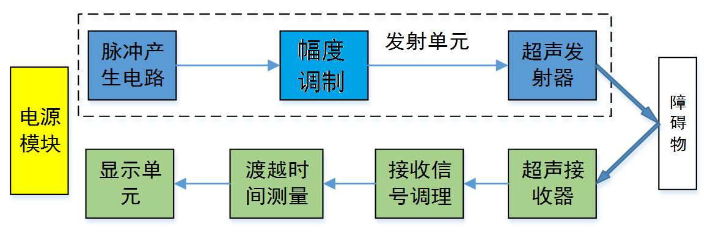
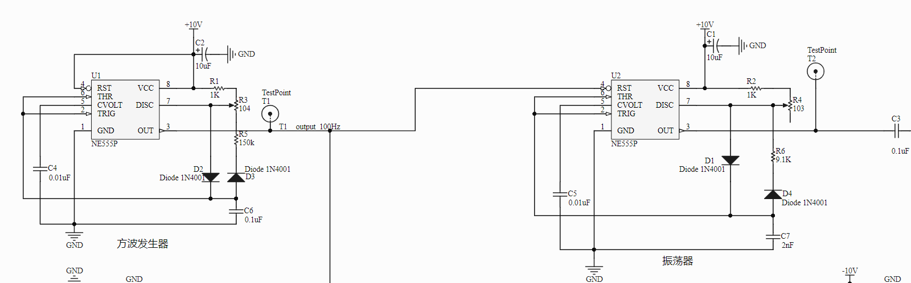
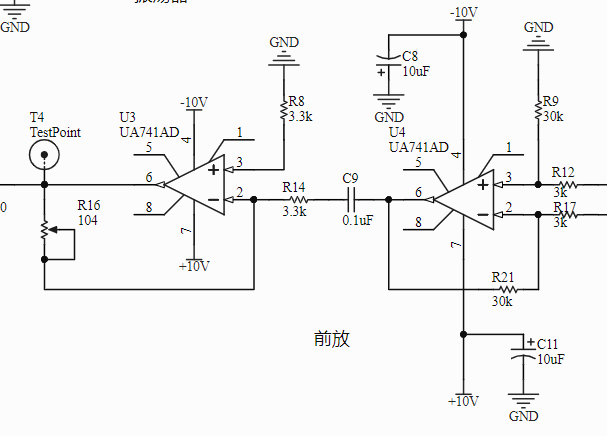
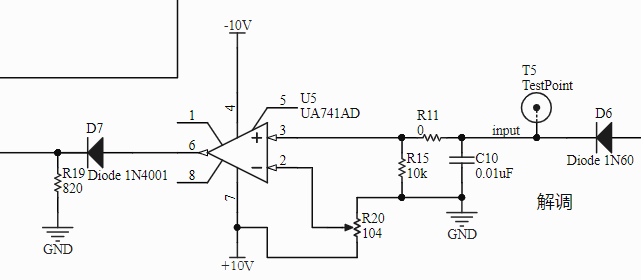
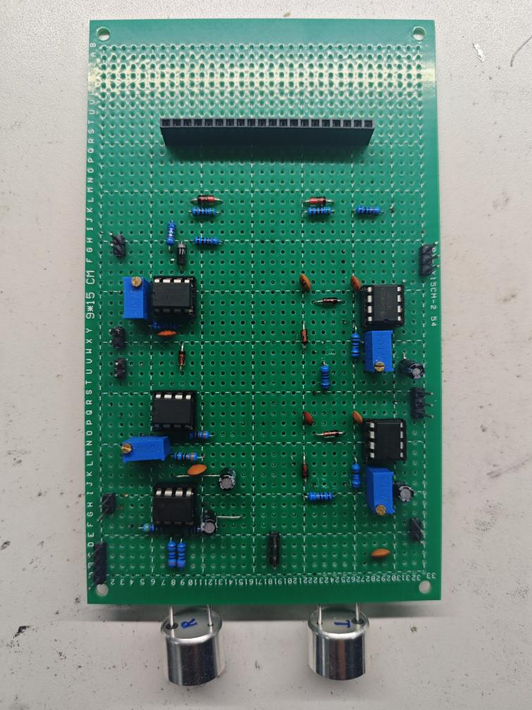
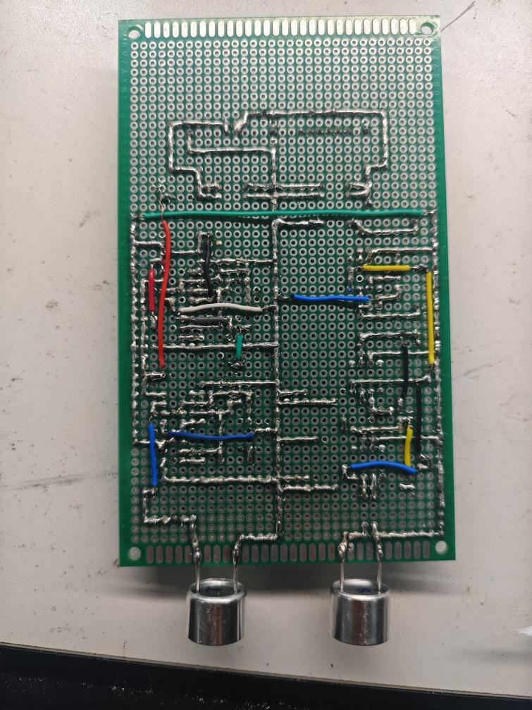

# 超声测距系统设计与测试

电工电子工程训练课程中的超声测距项目，采用 NE555 发射电路、UA741 接收调理电路与 FPGA 计时显示。此仓库用于保存设计报告、电路图、实物照片与实验数据。

## 系统组成

发射端由低频调制信号控制约 40.9 kHz 载波，驱动超声换能器；接收端经两级放大、包络检波和比较整形产生回波脉冲，FPGA 测量传播时间并计算距离。扩展功能包括 LED 距离分级、近距离蜂鸣器报警和手动温度参数补偿。

## 仓库内容

| 目录 | 内容 |
| --- | --- |
| `docs` | 保留原有技术内容的公开版实验报告 |
| `images` | 系统框图、发射与接收电路、实物正反面照片 |
| `data` | 从报告表格转录的换能器频率、占空比和最终测距数据 |

[下载公开版报告](docs/Ultrasonic-Ranging-Report.docx)。公开版移除了学生信息表、个人验收记录、证件照与联系方式；本地原始报告保持不变。

## 主要实验记录

- 在报告给定测试条件下，40.9 kHz 的接收幅度为 8.234 Vpp，是所测频点中的最大值。
- 占空比实验中，50% 激励的接收幅度为 6.5765 Vpp。
- 最终记录的测量范围约为 0.04—2 m；0.2、0.75、1.0 m 处绝对误差分别为 0.3、1.4、2.6 cm，2 m 处约为 10 cm。
- LED 按距离分级指示；距离小于 0.3 m 时发出声音报警。

上述值为原报告记录，本次上传未重新测量。调试阶段和最终测试阶段的数据分别保留，`data/final-distance-tests.csv` 对应报告表 4.7。

## 电路与实物

## 资料范围

原 FPGA 源码及可编辑电路工程已未能找到，因此本仓库提供设计与测试资料。报告中的局部代码截图属于实验记录，不能替代完整可编译工程。公式、电路图和参考文献保留在报告中。
